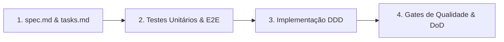

# Arquitetura & Spec-Driven Development

O Neo combina **Domain-Driven Design (DDD)** tático com **Spec-Driven Development (SDD)**. O objetivo é simples: manter o núcleo fácil de testar e garantir que cada comando novo nasça de um contrato claro antes de virar código.

---

## Arquitetura em Camadas

As dependências apontam sempre para dentro, isolando regras de negócio de detalhes de HTTP, terminal ou sistema operacional:

```text
interfaces (CLI) → application → domain ← infrastructure (integrations)
```

1. **`interfaces/` (`src/neo/cli.py` e `src/neo/commands/`):** Borda de entrada na linha de comando. Traduz argumentos do **Typer**, formata painéis e tabelas com **Rich** e serializa a saída quando `--json` está ativo.
2. **`application/` & `services/`:** Casos de uso da aplicação, como detecção automática de repositório Git via `remote`, resolução de provedor e análise contextual de stories.
3. **`domain/`:** Entidades, objetos de valor e protocolos (`GitProviderProtocol`, modelos de repositório, commit, workspace e story). Não importa bibliotecas de rede ou de interface.
4. **`infrastructure/` (`src/neo/integrations/` e `config.py`):** Adaptadores concretos para **GitHub**, **Bitbucket Cloud** e **Shortcut** usando `httpx`, além da persistência em `keyring` e arquivos TOML.

Essa separação é o que prepara o Neo para os próximos passos do roadmap — novos módulos de vida pessoal (estudos, lazer e finanças) e uma futura API pública entram como novos adaptadores e domínios sem reescrever a base.

---

## Como Funciona o Spec-Driven Development (SDD)

Nenhuma feature é implementada no improviso. Todo comando segue quatro etapas verificáveis em CI:



- **A spec é o contrato:** Cada funcionalidade começa em `specs/NNNN-*/spec.md` com critérios de aceite em formato *Given/When/Then* (`AC-1`, `AC-2`...).
- **Rastreabilidade ponta a ponta:** O script de auditoria valida se todo `AC-N` da especificação possui tarefa correspondente em `tasks.md` e teste automatizado cobrindo o cenário.
- **Gates automatizados no CI:** Todo push e Pull Request passa por linter (`ruff`), checagem estática de tipos em modo estrito (`mypy src`), compilação da documentação (`mkdocs build --strict`) e suíte `pytest` com cobertura mínima de `80%`.
- **Memória e decisões documentadas:** O estado atual do desenvolvimento fica em `docs/STATE.md`, e decisões arquiteturais difíceis de reverter são registradas como ADRs imutáveis em `docs/architecture/adr/`.
