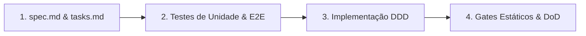

# Arquitetura & Governança

O Neo foi projetado utilizando os princípios de **Domain-Driven Design (DDD)** tático e **Spec-Driven Development (SDD)**, com uma clara separação em camadas onde as dependências apontam estritamente para dentro.

---

## Camadas da Aplicação

```
interfaces (CLI) → application → domain ← infrastructure (integrations)
```

1. **`interfaces/` (CLI):** Ponto de entrada do usuário via terminal implementado com Typer e Rich (`src/neo/cli.py` e `src/neo/commands/`).
2. **`application/` & `services/`:** Orquestração de casos de uso (como resolução de provedores e análise de tickets).
3. **`domain/`:** Modelos de dados e contratos/protocolos essenciais (`GitProviderProtocol`, DTOs de repositório, commit e workspace).
4. **`infrastructure/` (`integrations/` e `config.py`):** Clientes HTTP (`httpx`), gerenciador de credenciais (`keyring`) e adaptadores externos (Bitbucket, GitHub, Shortcut).

---

## Esteira Spec-Driven Development (SDD)

No Neo, o código fonte nunca antecede a especificação. Toda funcionalidade obedece ao ciclo:



- **Fonte da Verdade:** As especificações em `specs/NNNN-*/spec.md` contêm os critérios de aceite (Given/When/Then) que servem de oráculo para os testes.
- **Rastreabilidade Total:** Cada critério de aceite (`AC-N`) é mapeado na matriz de `tasks.md`, no teste automatizado correspondente e no histórico de commits.
- **Memória de Trabalho Viva:** O arquivo `docs/STATE.md` registra o progresso e próximos passos da equipe.
- **Decisões Arquiteturais Imutáveis:** Decisões estruturais são registradas como Architecture Decision Records (ADRs) em `docs/architecture/adr/`.
