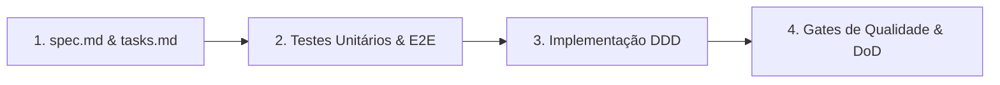

# Arquitetura & Spec-Driven Development

O Neo combina **Domain-Driven Design (DDD)** tático com **Spec-Driven Development (SDD)**. As regras de negócio ficam isoladas de detalhes de rede e terminal, e toda mudança nasce de uma especificação testável.

---

## Camadas da Aplicação

As dependências apontam sempre para dentro:

```text
interfaces (CLI) → application (resolver/services) → domain (models/protocols) ← infrastructure (integrations/config)
```

1. **`interfaces/` (`src/neo/cli.py` e `src/neo/commands/`):** Borda de entrada da CLI construída com **Typer** e **Rich**. Implementa a gramática `neo git <recurso> <ação> [--opções]`, valida parâmetros de uso (código `2`) e formata a saída em tabelas/painéis humanos ou JSON puro (`--json`).
2. **`application/` (`src/neo/integrations/resolver.py` e `src/neo/services/`):** Orquestra a resolução de provedor e workspace seguindo a cadeia de precedência (`CLI > ENV > config.toml > remote > default`), detecta metadados do repositório Git local e traduz exceções de domínio em códigos de saída padronizados (`0` a `5`).
3. **`domain/` (`src/neo/integrations/*_models.py` e protocolos):** Define os modelos de dados (`BitbucketRepo`, `BitbucketCommit`, `BitbucketWorkspace`) e o contrato comum de provedores Git.
4. **`infrastructure/` (`src/neo/integrations/github.py`, `bitbucket.py`, `shortcut.py` e `src/neo/config.py`):** Clientes HTTP (`httpx`), integração com o **Keyring** do sistema operacional e persistência em arquivos TOML (`0600`).

---

## Interface Comum de Provedores (`GitProviderProtocol`)

Para que `neo git workspace`, `neo git repo` e `neo git commits` funcionem de forma idêntica no **GitHub** e no **Bitbucket Cloud**, ambos os clientes implementam o contrato `GitProviderProtocol`:

```python
class GitProviderProtocol(Protocol):
    def list_workspaces(self) -> list[BitbucketWorkspace]: ...
    def get_default_workspace(self, ignore_config: bool = False) -> str: ...
    def list_repositories(
        self, workspace: str | None = None, limit: int | None = None
    ) -> list[BitbucketRepo]: ...
    def search_repositories(
        self, query: str, workspace: str | None = None, limit: int | None = None
    ) -> list[BitbucketRepo]: ...
    def get_repository(self, repo_slug: str, workspace: str | None = None) -> BitbucketRepo: ...
    def list_commits(
        self,
        repo_slug: str,
        workspace: str | None = None,
        author: str | None = None,
        query: str | None = None,
        limit: int = 20,
    ) -> list[BitbucketCommit]: ...
    def get_commit(
        self, repo_slug: str, sha: str, workspace: str | None = None
    ) -> BitbucketCommit: ...
```

Quando uma operação futura não for suportada por um dos provedores, o adaptador lança `UnsupportedProviderOperationError`, que a CLI converte automaticamente no código de saída `5` acompanhado de uma sugestão de alternativa.

---

## Decisões Arquiteturais (ADRs)

As decisões estruturais do projeto são imutáveis e ficam registradas em `docs/architecture/adr/`:

- **ADR-0002 (Tech Stack Core):** Python >= 3.13, `uv`, Typer, Rich, `httpx`, Pydantic e `keyring`.
- **ADR-0003 (Arquitetura Modular e Integrações):** Isolamento de clientes HTTP como *Anti-Corruption Layer (ACL)*.
- **ADR-0004 (Gestão de Credenciais e Segurança):** Keyring do SO como armazenamento primário, fallback `0600` (`credentials.toml`) e variáveis de ambiente para CI/CD.
- **ADR-0005 (Padrões de Qualidade e Testes):** Ruff, Mypy em modo `strict`, Pytest com `respx` (sem chamadas de rede real) e cobertura `>= 80%`.
- **ADR-0006 (Observabilidade e UX na CLI):** Dupla saída (Rich para humanos, `--json` estrito no `stdout` para automação) e códigos de saída semânticos.
- **ADR-0007 (Integração de Agentes de Codificação e Provedores SDD):** Interface unificada `neo config agent` e `neo agent`, adaptador para Google Antigravity CLI (`agy`), suporte aos provedores `spec-driven` e `spec-kit` e execução segura de subprocesso (`shell=False`) com repasse de sinais.

---

## Esteira Spec-Driven Development (SDD)

Nenhum comando é codificado antes da especificação:



- **Contrato executável:** Cada requisito em `specs/NNNN-*/spec.md` possui um identificador `AC-N` em formato *Given/When/Then*.
- **Rastreabilidade verificada em CI:** Os scripts `scripts/audit-esteira.mjs` e `scripts/eval-spec-fidelity.mjs` garantem que todo `AC-N` esteja mapeado em `tasks.md` e referenciado na suíte de testes automatizados.
