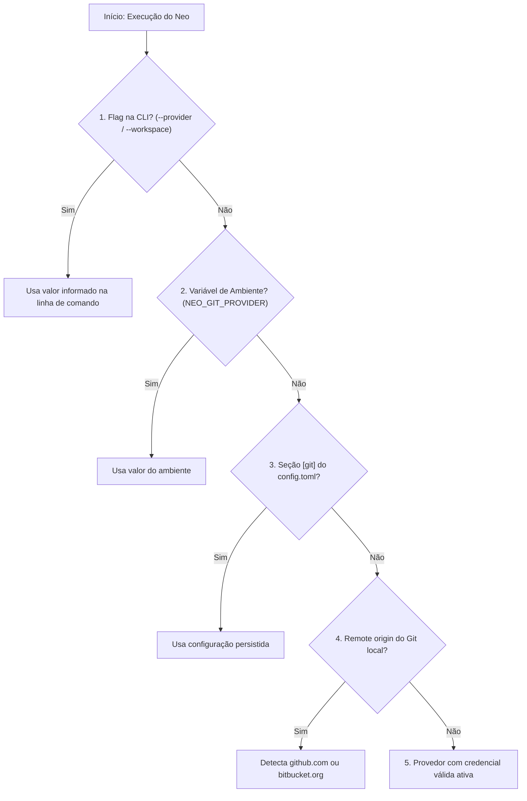

# neo git status
> Exibe o diagnóstico do repositório Git local, provedor resolvido, workspace e estado de autenticação.

O comando `neo git status` inspeciona o diretório atual de trabalho e consolida em uma única chamada todas as informações do contexto de desenvolvimento: se o diretório é um repositório Git válido, qual branch está ativa, quais são os remotes configurados, qual provedor foi inferido (`github` ou `bitbucket`) e se as credenciais necessárias estão presentes.

---

## Sintaxe

```bash
neo git status [--opções]
```

---

## Ações

| Ação | Descrição | Exemplo de comando |
|---|---|---|
| *(padrão)* | Diagnostica o repositório local e resolução de provedor/workspace | `neo git status` |

---

## Opções

As opções abaixo são específicas do comando `neo git status`. Para opções globais, consulte os [conceitos gerais](../index.md#opcoes-globais-vs-opcoes-de-recurso).

| Opção | Obrigatório | Padrão | Descrição |
|---|---|---|---|
| `--json` | Não | `False` | Emite o diagnóstico estruturado em formato JSON no `stdout`. |

---

## Camadas de Resolução de Contexto

O Neo resolve `provider` e `workspace` verificando as seguintes camadas em ordem decrescente de prioridade:



---

## Exemplos

### 1. Diagnóstico no terminal (leitura humana)
```bash
neo git status
```

Exemplo de visualização:
```text
╭─ Diagnóstico do Repositório Git ──────────────────────────╮
│ Repositório Local:  /Users/dev/projetos/neo (git)         │
│ Branch Atual:       feature/kanban                        │
│ Remote Origin:      git@github.com:empresa/neo.git        │
│ Provedor Resolvido: github (origem: remote)               │
│ Workspace:          empresa (origem: remote)              │
│ Repositório:        neo (origem: remote)                  │
│ Autenticação:       ✓ Autenticado (keyring: gh_pat_***)   │
╰───────────────────────────────────────────────────────────╯
```

### 2. Automação em scripts e CI (`--json`)
=== "Consultar se o diretório está autenticado"
    ```bash
    neo git status --json | jq -r '.authenticated'
    ```

=== "Obter o slug do workspace resolvido"
    ```bash
    neo git status --json | jq -r '.workspace'
    ```

---

## Erros comuns e códigos de saída

* **Código 0 (Sucesso):** Diagnóstico concluído com sucesso (mesmo fora de uma pasta Git, os dados resolvidos de configuração e autenticação são reportados).
* **Código 3 (Erro de autenticação):** O provedor resolvido não possui token configurado ou a credencial falhou no teste de validação.

---

## Veja também
- [neo git auth](auth.md) — Configurar ou verificar credenciais de acesso
- [neo git workspace](workspace.md) — Listar e selecionar workspaces remotos
- [neo agent status](../agent/status.md) — Diagnóstico da esteira SDD e agente Antigravity
