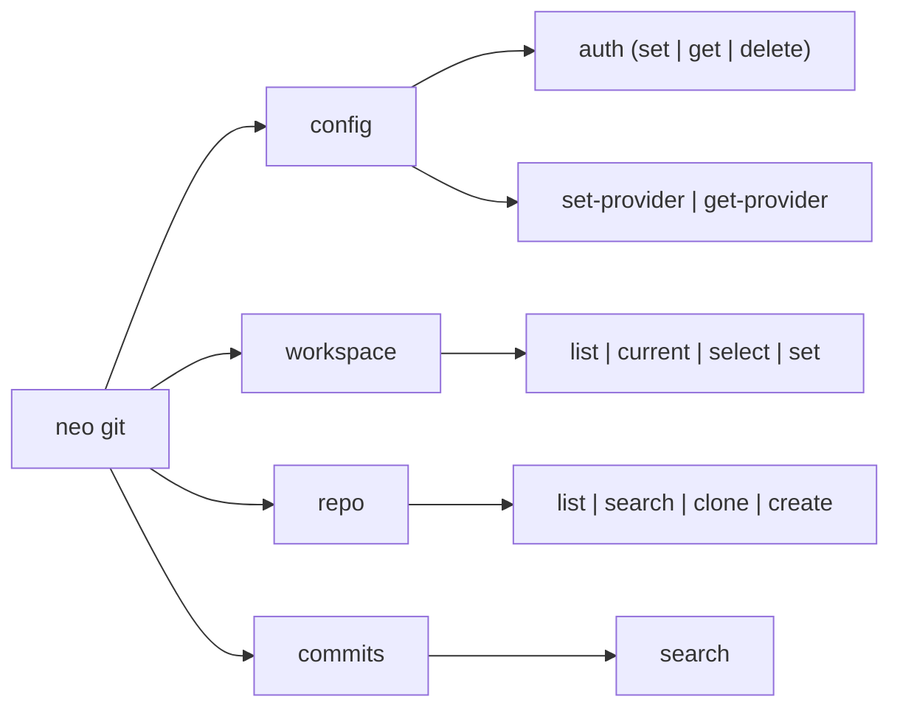
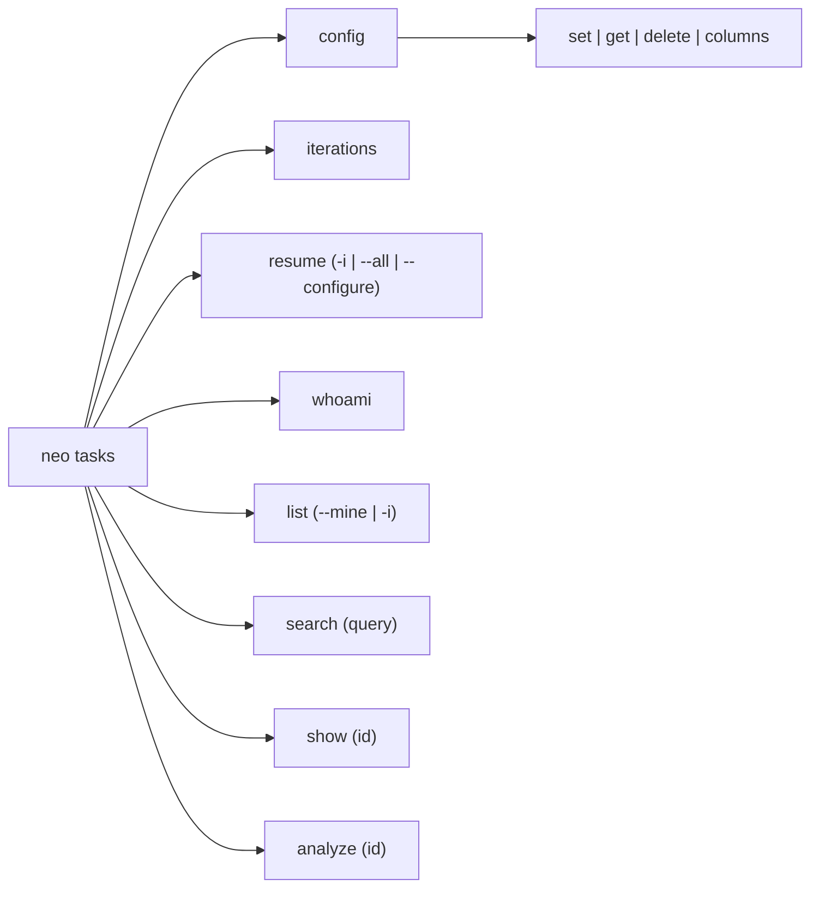
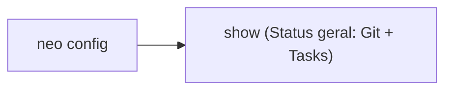

# Guia de Comandos da CLI

A interface de linha de comando do Neo foi projetada para ser rápida, visualmente agradável com **Rich** e totalmente integrável a pipelines de automação.

---

## Opções Globais

Todas as invocações aceitam as seguintes opções no início do comando:

| Flag | Descrição |
|---|---|
| `--help` | Exibe a mensagem de ajuda contextual do comando. |
| `--version`, `-V` | Exibe a versão atual instalada do Neo. |
| `--json` | Emite a saída em formato JSON estrito no `stdout`, suprimindo formatação visual. |
| `-v`, `--verbose` | Habilita logs detalhados de requisições HTTP e depuração interna. |

### Exemplo de Uso com `--json` e `jq`

```bash
# Filtrar nomes de repositórios diretamente com jq
neo --json git repo list | jq -r '.[].slug'
```

---

## Módulos Disponíveis

Os comandos do Neo são organizados em módulos independentes por categoria de serviço:

### 1. Mapa do Módulo `neo git` (Bitbucket & GitHub)

Centraliza autenticação, seleção de workspaces/organizações, gestão de repositórios e histórico de commits:



- [Configuração Git](../configuration.md) (`neo git config`): Credenciais e provedor padrão (`bitbucket` ou `github`).
- [Workspaces](workspace.md) (`neo git workspace`): Alternância e listagem de workspaces/organizações ativas.
- [Repositórios](repo.md) (`neo git repo`): Listagem, busca, clonagem e criação de repositórios.
- [Commits](commits.md) (`neo git commits`): Investigação de histórico com auto-detecção do repositório Git local.

---

### 2. Mapa do Módulo `neo tasks` (Shortcut)

Centraliza a gestão de credenciais, consulta de stories/chamados e análise contextual de demandas (com seletor `--service`):



- [Configuração de Tasks](../configuration.md) (`neo tasks config`): Armazenamento seguro do token e mapeamento das colunas do board (`columns`).
- [Tasks & Demandas](tasks.md) (`neo tasks`): Iterações (`iterations`), quadro Kanban (`resume`), consulta de stories (`whoami`, `list`, `search`, `show`) e análise automática de contexto (`analyze`).

---

### 3. Visão Geral de Configuração (`neo config`)



- [Visão Geral](../configuration.md) (`neo config show`): Painel consolidado com o status de todas as integrações e provedor Git padrão.
