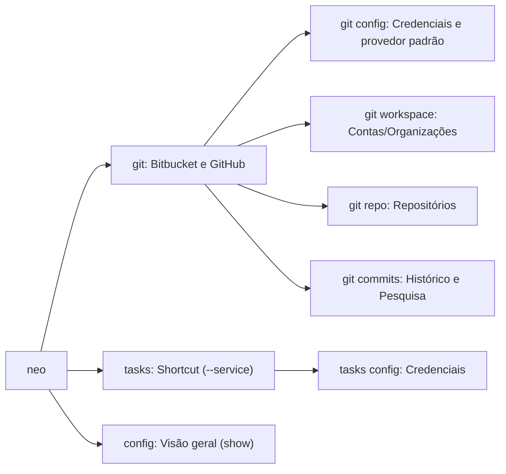

# Guia de Comandos da CLI

A interface de linha de comando do Neo foi projetada para ser rápida, visualmente agradável com **Rich** e totalmente integrável a pipelines de automação.

---

## Opções Globais

Todas as invocações aceitam as seguintes opções no início do comando:

| Flag | Descrição |
|---|---|
| `--help` | Exibe a mensagem de ajuda contextual do comando. |
| `--version`, `-V` | Exibe a versão atual instalada do Neo. |
| `--json` | Emite a saída em formato JSON estrito no `stdout`, suprimindo formatação visual. |
| `-v`, `--verbose` | Habilita logs detalhados de requisições HTTP e depuração interna. |

### Exemplo de Uso com `--json` e `jq`

```bash
# Filtrar nomes de repositórios diretamente com jq
uv run neo --json git repo list | jq -r '.[].slug'
```

---

## Módulos Disponíveis

Os comandos são agrupados por categoria de serviço:



- [Workspaces](workspace.md) (`neo git workspace`): Alternância e listagem de workspaces/organizações ativas.
- [Repositórios](repo.md) (`neo git repo`): Listagem, busca, clonagem e criação de repositórios.
- [Commits](commits.md) (`neo git commits`): Investigação de histórico com auto-detecção git.
- [Tasks](tasks.md) (`neo tasks`): Consulta de chamados e análise automática de contexto.

A configuração fica em `neo git config` (Bitbucket/GitHub) e `neo tasks config` (Shortcut); veja [Configuração](../configuration.md).
