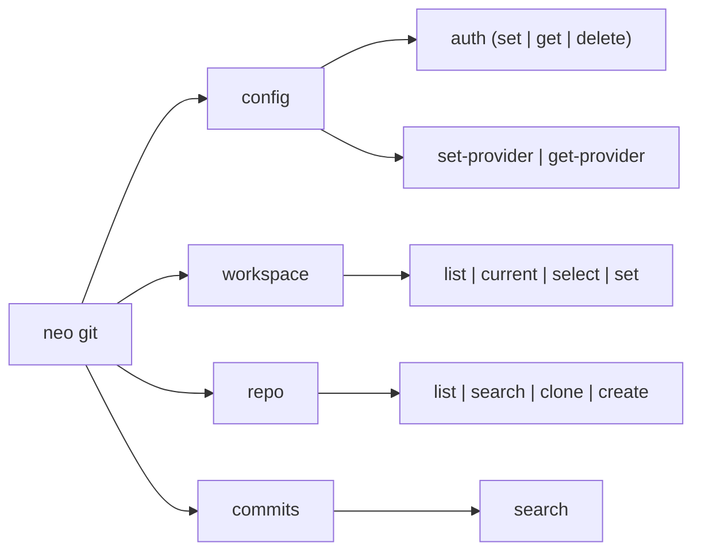
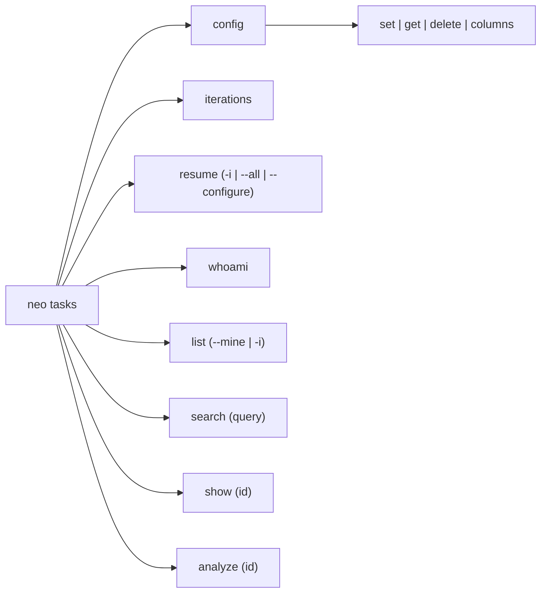
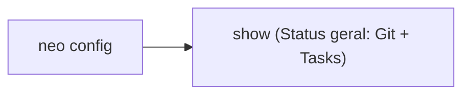

# Visão Geral da CLI

Os comandos do Neo seguem o padrão `neo <domínio> <recurso> <ação>`. Você recebe tabelas formatadas com **Rich** para leitura rápida no terminal ou JSON puro com `--json` para alimentar scripts, `jq` e pipelines de CI/CD.

---

## Flags Globais

Passe as flags globais logo após `neo`, antes do subcomando:

| Flag | O que faz |
|---|---|
| `--help` | Exibe a ajuda rápida do comando ou subcomando atual. |
| `--version`, `-V` | Imprime a versão instalada do Neo e encerra. |
| `--json` | Emite JSON puro no `stdout` e desativa cores/tabelas visuais. |
| `-v`, `--verbose` | Exibe detalhes de chamadas HTTP e diagnóstico em caso de falha. |

### Compondo Comandos no Terminal (`--json` + `jq`)

```bash
# Extrair apenas os slugs dos seus repositórios no provedor ativo
neo --json git repo list | jq -r '.[].slug'

# Contar quantas tasks estão na coluna "Fazendo" na sprint atual
neo --json tasks resume | jq '.doing | length'

# Clonar todos os repositórios que contêm "service" no nome
neo --json git repo search service | jq -r '.[].slug' | xargs -I {} neo git repo clone {}
```

---

## Mapa de Comandos Hoje

### 1. `neo git` (GitHub & Bitbucket Cloud)

Gerencia credenciais, organizações/workspaces, repositórios e busca de commits nos dois provedores com a mesma sintaxe:



- [Configuração Git](../configuration.md) (`neo git config`): salve tokens no Keyring e escolha seu provedor padrão (`github` ou `bitbucket`).
- [Workspaces](workspace.md) (`neo git workspace`): alterne entre organizações ou contas sem precisar passar flags em todo comando.
- [Repositórios](repo.md) (`neo git repo`): liste, filtre, crie e clone repositórios via SSH ou HTTPS.
- [Commits](commits.md) (`neo git commits`): pesquise commits por autor ou mensagem com detecção automática do repositório local.

---

### 2. `neo tasks` (Shortcut)

Conecta seu terminal ao **Shortcut** para visualizar quadros Kanban, filtrar sprints e preparar o contexto antes de abrir uma branch:



- [Configuração de Tasks](../configuration.md) (`neo tasks config`): configure o token do Shortcut e mapeie as colunas do seu workflow.
- [Tasks & Demandas](tasks.md) (`neo tasks`): veja o quadro Kanban (`resume`), liste sprints (`iterations`), filtre stories (`list`, `search`, `show`) e gere sugestões de branch e commit (`analyze`).

---

### 3. `neo config` (Diagnóstico Geral)



- [Diagnóstico de Configuração](../configuration.md) (`neo config show`): confira em uma tabela quais tokens estão ativos, de onde vêm (Keyring, variável de ambiente ou arquivo) e qual provedor Git é o padrão.
