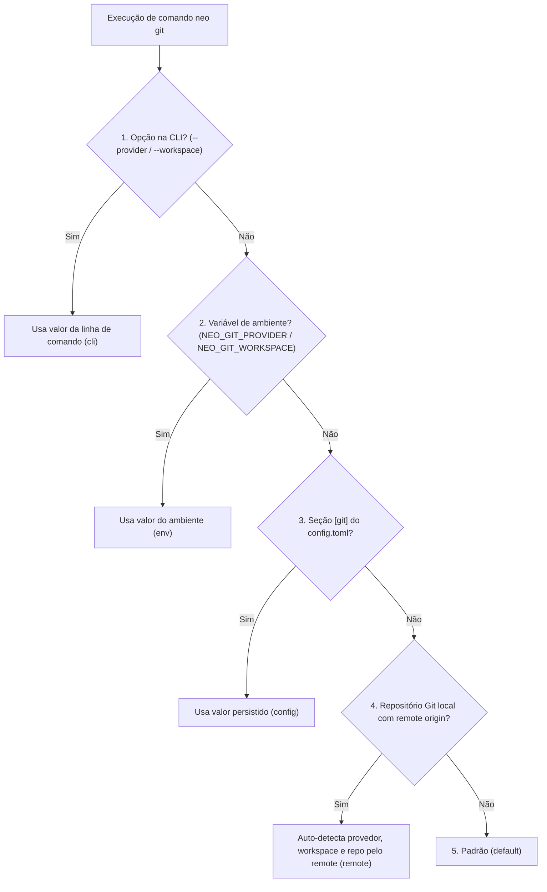

# Configurações do Git

O Neo armazena as preferências de repositórios, workspaces e provedores Git na seção `[git]` do arquivo `~/.config/neo/config.toml` com permissão `0600`.

---

## Seção `[git]` do `config.toml`

Exemplo de configuração padrão:

```toml
[git]
provider = "github"
workspace = "minha-organizacao"
default-branch = "main"
branch-pattern = "{type}/{id}-{slug}"
commit-format = "{type}: {message}"
```

### Tabela de Chaves Suportadas (`neo git config`)

| Chave | Valores aceitos | Valor padrão | Descrição |
|---|---|---|---|
| `provider` | `github` \| `bitbucket` | *(auto/fallback)* | Provedor Git padrão quando fora de um repositório Git local. |
| `workspace` | `<slug>` (texto não-vazio) | *(auto via API)* | Workspace (Bitbucket) ou organização/usuário (GitHub) padrão. |
| `api-key` | Entrada oculta | — | Credencial validada no provedor configurado. |
| `repo` | Caminho local | — | Repositório selecionado. |
| `branch` | Nome da branch | Branch ativa | Fazer checkout no repositório selecionado. |
| `task` | ID da tarefa | — | Task associada ao repositório selecionado. |
| `default-branch` | Ex.: `main`, `master`, `develop` | `main` | Nome da branch principal padrão para operações Git. |
| `branch-pattern` | Ex.: `{type}/{id}-{slug}` | `{type}/{id}-{slug}` | Padrão de nomenclatura sugerido para branches. |
| `commit-format` | Ex.: `{type}: {message}` | `{type}: {message}` | Formato padrão sugerido para mensagens de commit. |

```bash
# Definir e consultar valores
neo git config set provider github
neo git config set workspace minha-organizacao
neo git config get provider
neo git config list

# Restaurar uma chave para o valor padrão
neo git config unset default-branch
```

!!! info "Segurança: `token` não é uma chave de configuração"
    A chave `token` é rejeitada por `neo git config` com erro de uso incorreto (código `2`). Use sempre [`neo git config set api-key`](../../cli/git/auth.md) ou variáveis de ambiente.

---

## Ordem de Precedência de Configuração (`provider` e `workspace`)

Quando você executa qualquer comando `neo git`, o provedor e o workspace são resolvidos exatamente nesta ordem:



1. **Opção de linha de comando:** `--provider <github|bitbucket>` e `--workspace <slug>`.
2. **Variáveis de ambiente de contexto:** `NEO_GIT_PROVIDER` e `NEO_GIT_WORKSPACE`.
3. **Seção `[git]` do `~/.config/neo/config.toml`:** chaves `provider` e `workspace`.
4. **Auto-detecção pelo `remote origin`:** analisa a URL do repositório Git atual (`github.com` ou `bitbucket.org`).
5. **Padrão:** `github` se apenas o GitHub estiver autenticado; caso contrário, `bitbucket` (e o primeiro workspace retornado pela API).

Use `neo git status` para ver de qual camada cada valor foi resolvido para o repositório selecionado ou, sem seleção, para o diretório atual.

---

## Autenticação e Credenciais

### Armazenamento Local (`neo git config set api-key`)

1. **Keyring do Sistema Operacional (prioritário):**
   - macOS: *Keychain Access*
   - Linux: *Secret Service / Freedesktop*
   - Windows: *Windows Credential Manager*
2. **Arquivo de Credenciais Restrito (fallback):**
   - Caminho: `~/.config/neo/credentials.toml`
   - Permissão obrigatória: `0600` (leitura e escrita apenas pelo seu usuário).

!!! warning "Bitbucket Cloud: use API Token + E-mail"
    As antigas *App Passwords* do Bitbucket Cloud foram descontinuadas pela Atlassian. O Bitbucket Cloud exige o **e-mail da conta** e um **API Token**. Após configurar o provedor, `neo git config set api-key` solicita ambos de forma segura.

### Variáveis de Ambiente para Automação e CI/CD

Em pipelines de CI/CD ou scripts automatizados, defina as variáveis de ambiente abaixo:

| Provedor / Contexto | Variável Principal | Alternativas Aceitas | Descrição |
|---|---|---|---|
| **GitHub** | `NEO_GITHUB_TOKEN` | `GITHUB_TOKEN`, `GH_TOKEN` | Personal Access Token do GitHub (Classic ou Fine-grained). |
| **Bitbucket Cloud** | `NEO_BITBUCKET_EMAIL` | — | E-mail da conta Atlassian usada na autenticação Basic da API. |
| **Bitbucket Cloud** | `NEO_BITBUCKET_TOKEN` | `BITBUCKET_TOKEN` | API Token do Bitbucket Cloud. |
| **Contexto Git** | `NEO_GIT_PROVIDER` | — | Força o provedor padrão (`github` ou `bitbucket`). |
| **Contexto Git** | `NEO_GIT_WORKSPACE` | — | Força o workspace ou organização padrão. |
