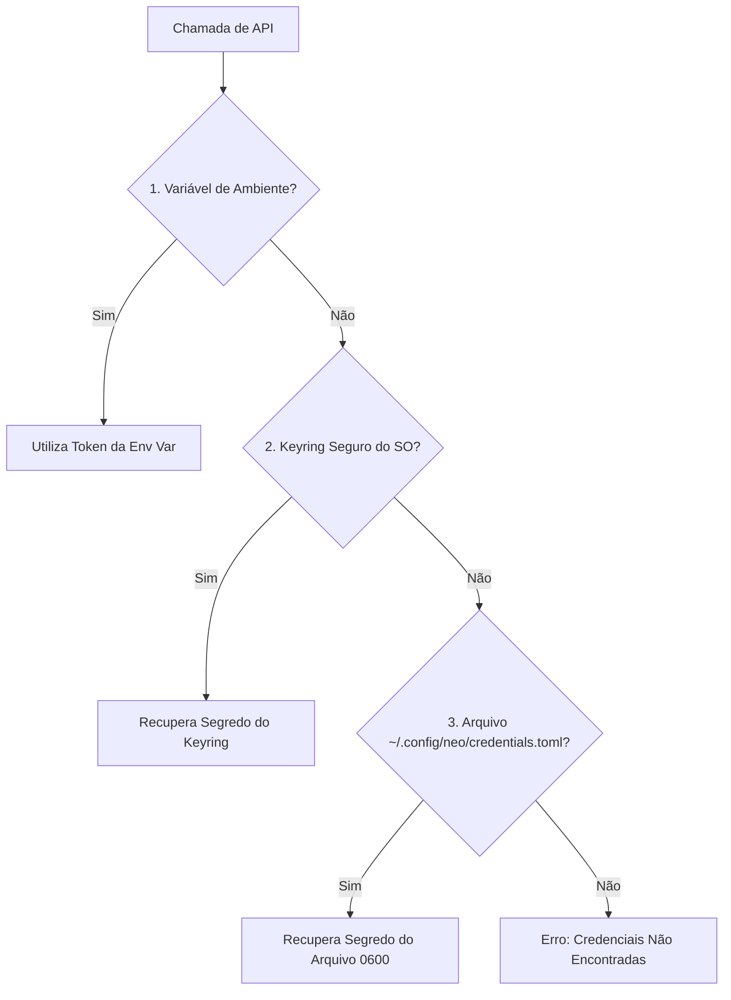

# Configuração & Credenciais

O Neo adota princípios de **Segurança por Padrão** (*Security by Default*). Suas credenciais e preferências de trabalho nunca ficam desprotegidas no disco.

---

## Modelo de Precedência de Credenciais

Ao buscar um token de API para qualquer serviço (`bitbucket`, `github` ou `shortcut`), o Neo consulta as seguintes fontes em ordem estrita de prioridade:



1. **Variáveis de Ambiente:**
   - `BITBUCKET_TOKEN`
   - `GITHUB_TOKEN`
   - `SHORTCUT_TOKEN`
2. **Keyring Seguro do Sistema Operacional:**
   - macOS: *Keychain Access*
   - Linux: *Secret Service API / Freedesktop*
   - Windows: *Windows Credential Locker*
3. **Arquivo Local Criptografado/Protegido:**
   - Localização: `~/.config/neo/credentials.toml`
   - Permissão estrita: `0600` (leitura e escrita apenas pelo proprietário).

---

## Comandos de Gerenciamento (`neo config`)

### Visualizar Status das Integrações
```bash
uv run neo config show
```

### Definir e Consultar Tokens
=== "Interativo (Oculto)"
    ```bash
    uv run neo config auth set shortcut
    # O terminal solicitará o token com digitação oculta
    ```

=== "Via Flag Direta"
    ```bash
    uv run neo config auth set github --token "ghp_meu_token"
    ```

=== "Consultar Token Mascarado"
    ```bash
    uv run neo config auth get github
    ```

=== "Remover Credencial"
    ```bash
    uv run neo config auth delete bitbucket
    ```

---

## Configuração do Provedor Git Padrão

Se você trabalha simultaneamente com repositórios no **GitHub** e no **Bitbucket**, pode definir qual deles é o padrão global quando uma flag explícita não for fornecida:

```bash
# Definir GitHub como padrão
uv run neo config set-provider github

# Definir Bitbucket como padrão
uv run neo config set-provider bitbucket

# Consultar provedor padrão atual
uv run neo config get-provider
```

Essa configuração é salva no arquivo `~/.config/neo/config.toml`.
