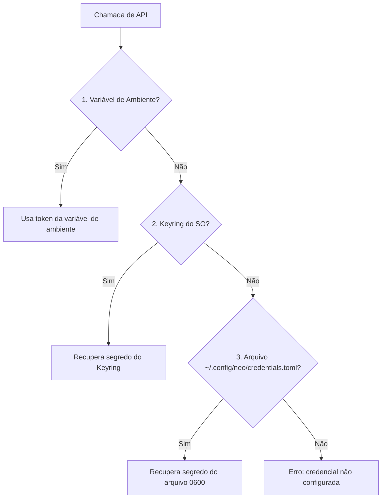

# Configuração & Credenciais

O Neo nunca salva tokens em texto aberto sem proteção. Você pode usar o **Keyring do sistema operacional** no seu computador pessoal e **variáveis de ambiente** em pipelines de CI/CD sem mudar uma linha nos seus scripts.

---

## Ordem de Precedência de Credenciais

Sempre que um comando chama a API do **GitHub**, **Bitbucket Cloud** ou **Shortcut**, o Neo resolve o token nesta ordem:



1. **Variáveis de Ambiente (ideal para CI/CD e containers):**
   - `GITHUB_TOKEN`
   - `BITBUCKET_TOKEN`
   - `SHORTCUT_TOKEN`
2. **Keyring Nativo do Sistema Operacional (padrão no desktop):**
   - macOS: *Keychain Access*
   - Linux: *Secret Service API / Freedesktop*
   - Windows: *Windows Credential Manager*
3. **Fallback Local Restrito:**
   - Caminho: `~/.config/neo/credentials.toml`
   - Permissão forçada: `0600` (leitura e escrita restritas ao seu usuário).

---

## Comandos de Configuração

Cada domínio gerencia suas credenciais: **`neo git config`** para provedores Git e **`neo tasks config`** para gestão de tarefas. O comando raiz **`neo config show`** exibe o diagnóstico consolidado.

### Ver Diagnóstico Geral (`neo config show`)

```bash
# Exibe provedor padrão, workspaces ativos e status de cada token
neo config show

# Versão em JSON para healthcheck em scripts
neo --json config show
```

### Credenciais Git (`neo git config auth`)

=== "Prompt Oculto (Recomendado)"
    ```bash
    # Solicita o token sem exibi-lo na tela nem gravar no history do shell
    neo git config auth set github
    neo git config auth set bitbucket
    ```

=== "Via Flag (`--token`)"
    ```bash
    neo git config auth set github --token "ghp_meu_token"
    ```

=== "Consultar Token Mascarado"
    ```bash
    neo git config auth get github
    ```

=== "Remover Token"
    ```bash
    neo git config auth delete bitbucket
    ```

### Provedor Git Padrão (`neo git config`)

Quando você executa `neo git repo list` fora de um repositório Git e sem passar `--provider / -p`, o Neo usa o provedor padrão salvo em `~/.config/neo/config.toml`:

```bash
# Definir GitHub como padrão global
neo git config set-provider github

# Definir Bitbucket como padrão global
neo git config set-provider bitbucket

# Consultar qual provedor está ativo como padrão
neo git config get-provider
```

---

### Credenciais e Colunas de Tasks (`neo tasks config`)

=== "Prompt Oculto (Recomendado)"
    ```bash
    neo tasks config set
    ```

=== "Via Flag (`--token`)"
    ```bash
    neo tasks config set --service shortcut --token "seu_token"
    ```

=== "Consultar ou Remover Token"
    ```bash
    neo tasks config get
    neo tasks config delete
    ```

=== "Mapear Colunas do Quadro Kanban"
    ```bash
    # Assistente interativo: busca os estados reais do seu workflow na API
    neo tasks config columns

    # Ou defina diretamente por flag (aceita múltiplas colunas separadas por vírgula)
    neo tasks config columns \
      --todo "📝 - Backlog de Sprint, 🚨 - Bug" \
      --doing "🚧 - Em Progresso" \
      --done "✅ - Finalizado"
    ```

---

## Como Funciona o Mapeamento do Quadro (`neo tasks resume`)

O comando `neo tasks resume` agrupa suas tarefas em três colunas no terminal: **A fazer**, **Fazendo** e **Feito**. Como cada time usa nomes diferentes de etapa no Shortcut, o Neo salva a correspondência em `~/.config/neo/config.toml`:

```toml
[shortcut]
todo_columns = ["📝 - Backlog de Sprint", "🚨 - Bug"]
doing_columns = ["🚧 - Em Progresso"]
done_columns = ["✅ - Finalizado"]
```

Se você rodar `neo tasks resume` pela primeira vez sem ter configurado as colunas, o próprio comando consulta os estados do seu workflow na API e abre o seletor interativo antes de desenhar o quadro.

!!! warning "Comandos legados removidos"
    Os caminhos antigos da versão inicial (`neo config auth`, `neo repo`, `neo workspace`, `neo commits` e `neo story`) foram substituídos por `neo git ...` e `neo tasks ...`.
