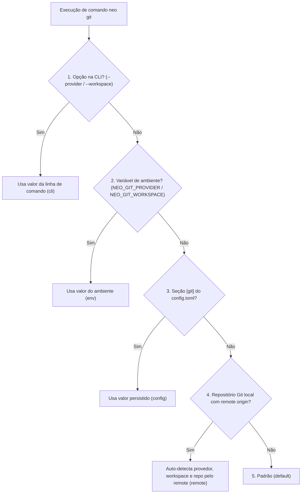

# Configuração & Credenciais

O Neo separa **configuração de preferências** (`~/.config/neo/config.toml`) de **credenciais de autenticação** (Keyring do sistema operacional ou `~/.config/neo/credentials.toml`). A chave `token` não existe em `neo git config`.

---

## Seção `[git]` do `config.toml`

O arquivo `~/.config/neo/config.toml` armazena suas preferências de trabalho na seção `[git]` com permissão `0600`:

```toml
[git]
provider = "github"
workspace = "minha-organizacao"
default-branch = "main"
branch-pattern = "{type}/{id}-{slug}"
commit-format = "{type}: {message}"
```

### Tabela de Chaves Suportadas (`neo git config`)

| Chave | Valores aceitos | Valor padrão | Descrição |
|---|---|---|---|
| `provider` | `github` \| `bitbucket` | *(auto/fallback)* | Provedor Git padrão quando fora de um repositório Git local. |
| `workspace` | `<slug>` (texto não-vazio) | *(auto via API)* | Workspace (Bitbucket) ou organização/usuário (GitHub) padrão. |
| `default-branch` | Ex.: `main`, `master`, `develop` | `main` | Nome da branch principal padrão para operações Git. |
| `branch-pattern` | Ex.: `{type}/{id}-{slug}` | `{type}/{id}-{slug}` | Padrão de nomenclatura sugerido para branches. |
| `commit-format` | Ex.: `{type}: {message}` | `{type}: {message}` | Formato padrão sugerido para mensagens de commit. |

```bash
# Definir e consultar valores
neo git config set provider github
neo git config set workspace minha-organizacao
neo git config get provider
neo git config list

# Restaurar uma chave para o valor padrão
neo git config unset default-branch
```

!!! info "Segurança: `token` não é uma chave de configuração"
    A chave `token` é rejeitada por `neo git config` com erro de uso incorreto (código `2`). Use sempre [`neo git auth login`](cli/git/auth.md) ou variáveis de ambiente.

---

## Ordem de Precedência de Configuração (`provider` e `workspace`)

Quando você executa qualquer comando `neo git`, o provedor e o workspace são resolvidos exatamente nesta ordem:



1. **Opção de linha de comando:** `--provider <github|bitbucket>` e `--workspace <slug>`.
2. **Variáveis de ambiente de contexto:** `NEO_GIT_PROVIDER` e `NEO_GIT_WORKSPACE`.
3. **Seção `[git]` do `~/.config/neo/config.toml`:** chaves `provider` e `workspace`.
4. **Auto-detecção pelo `remote origin`:** analisa a URL do repositório Git atual (`github.com` ou `bitbucket.org`).
5. **Padrão:** `github` se apenas o GitHub estiver autenticado; caso contrário, `bitbucket` (e o primeiro workspace retornado pela API).

Use `neo git status` para ver de qual camada cada valor foi resolvido no diretório atual.

---

## Autenticação e Variáveis de Ambiente

### Armazenamento Local (`neo git auth login`)

1. **Keyring do Sistema Operacional (prioritário):**
   - macOS: *Keychain Access*
   - Linux: *Secret Service / Freedesktop*
   - Windows: *Windows Credential Manager*
2. **Arquivo de Credenciais Restrito (fallback):**
   - Caminho: `~/.config/neo/credentials.toml`
   - Permissão obrigatória: `0600` (leitura e escrita apenas pelo seu usuário).

!!! warning "Bitbucket Cloud: use API Token + E-mail"
    As antigas *App Passwords* do Bitbucket Cloud foram descontinuadas pela Atlassian. O Bitbucket Cloud exige o **e-mail da conta** e um **API Token**. O comando `neo git auth login --provider bitbucket` solicita ambos de forma segura.

### Variáveis de Ambiente para Automação e CI/CD

Em pipelines de CI/CD ou scripts automatizados, defina as variáveis de ambiente abaixo (elas têm prioridade sobre o Keyring e sobre `credentials.toml`):

| Provedor / Contexto | Variável Principal | Alternativas Aceitas | Descrição |
|---|---|---|---|
| **GitHub** | `NEO_GITHUB_TOKEN` | `GITHUB_TOKEN`, `GH_TOKEN` | Personal Access Token do GitHub (Classic ou Fine-grained). |
| **Bitbucket Cloud** | `NEO_BITBUCKET_EMAIL` | — | E-mail da conta Atlassian usada na autenticação Basic da API. |
| **Bitbucket Cloud** | `NEO_BITBUCKET_TOKEN` | `BITBUCKET_TOKEN` | API Token do Bitbucket Cloud. |
| **Contexto Git** | `NEO_GIT_PROVIDER` | — | Força o provedor padrão (`github` ou `bitbucket`). |
| **Contexto Git** | `NEO_GIT_WORKSPACE` | — | Força o workspace ou organização padrão. |
| **Agente de IA** | `NEO_AGENT_CODE` | — | Força o executável do agente (ex.: `agy`). |
| **Agente de IA** | `NEO_AGENT_MODEL` | — | Força o identificador de modelo repassado ao agente (ex.: `"Gemini 3.8 Flash"`). |
| **Provedor SDD** | `NEO_SDD_PROVIDER` | — | Força a ferramenta SDD (`spec-driven` ou `spec-kit`). |
| **Shortcut (Tasks)** | `SHORTCUT_API_TOKEN` | `SHORTCUT_TOKEN` | Token da API v3 do Shortcut para `neo tasks`. |

```bash
# Exemplo em pipeline de CI/CD (GitHub)
export NEO_GIT_PROVIDER="github"
export NEO_GIT_WORKSPACE="minha-org"
export NEO_GITHUB_TOKEN="ghp_exemplo_ci"

neo git repo list --json | jq '.[].slug'
```

Nenhum comando do Neo imprime o token em logs, mensagens de erro, `--verbose` ou `--json`.

---

## Configuração do Módulo `neo tasks` (Shortcut)

O módulo `neo tasks` mantém suas próprias configurações de credenciais e mapeamento de colunas do quadro Kanban:

```bash
# Salvar token do Shortcut (prompt oculto)
neo tasks config set

# Mapear colunas A fazer | Fazendo | Feito do comando neo tasks resume
neo tasks config columns
```

---

## Seção `[agent]` do `config.toml` (`neo config agent`)

As preferências do agente de codificação (**Google Antigravity CLI**) e do provedor de Spec-Driven Development ficam na seção `[agent]` de `~/.config/neo/config.toml`:

```toml
[agent]
adapter = "antigravity"
command = "agy"
model = "Gemini 3.8 Flash"
sdd-provider = "spec-driven"
```

```bash
# Validar e salvar executável, modelo e provedor SDD
neo config agent set command agy
neo config agent set model "Gemini 3.8 Flash"
neo config agent set sdd-provider spec-driven
neo config agent list
```

Consulte a referência completa em [`neo agent` & `neo config agent`](cli/agent/index.md).
