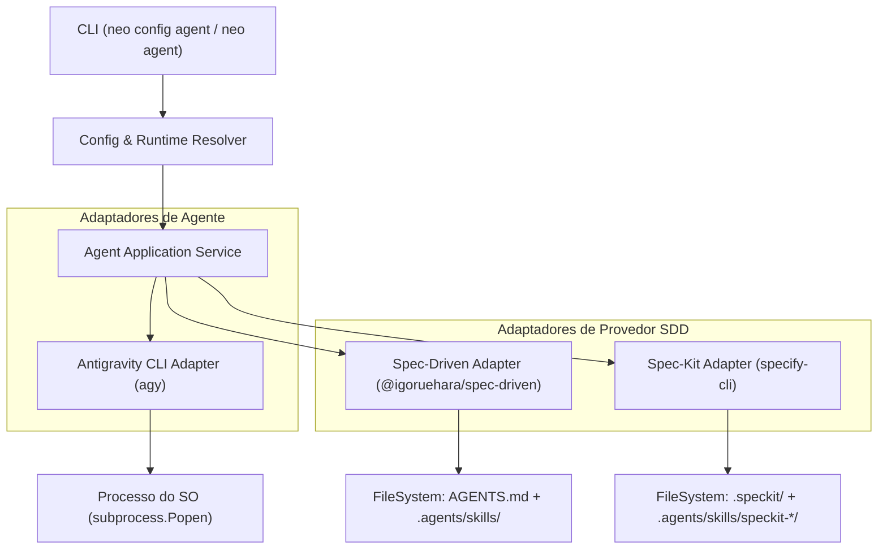

# Technical Design Doc — Integração Antigravity CLI e Provedores SDD

> **Tier:** arquitetural · **Status:** aprovado  
> **Autor:** Thalyson · **Data:** 2026-10-28  

## Links e artefatos

| Artefato | Onde | Link |
|---|---|---|
| Product | repositório | `./product.md` |
| Domínio | repositório | `./domain.md` |
| Spec | repositório | `./spec.md` |
| Tasks | repositório | `./tasks.md` |
| ADR Relacionado | repositório | `docs/architecture/adr/0007-integracao-agente-antigravity-e-sdd.md` |

## Contexto da funcionalidade

O Neo unifica a configuração de agentes de IA sob o comando `neo config agent` e as operações de ciclo de vida do agente sob `neo agent`. O primeiro agente suportado é o **Google Antigravity CLI** (`agy`), e os provedores SDD suportados são **`spec-driven`** e **`spec-kit`**.

## Goals / Non-goals

**Goals:**
- Configuração unificada e coesa através de `neo config agent set <chave> <valor>`, `get`, `list` e `unset`.
- Chaves suportadas: `command` (ou `agent-code`), `model`, `sdd-provider` (ou `sdd`), `adapter`.
- Validar binários no PATH com timeout e sem execução de shell arbitrário.
- Fornecer comandos operacionais sob `neo agent`: `status`, `setup` e `run`.
- Permitir overrides de flags na execução sem alterar configurações persistidas.
- Garantir terminal interativo com encaminhamento de sinais `SIGINT`/`SIGTERM` para evitar processos zumbis/órfãos.

**Non-goals:**
- Implementar clientes HTTP diretos para APIs de LLM.
- Implementar orquestração total de workflows de outros agentes além do Antigravity neste incremento.

## Glossário (da funcionalidade)

| Termo | Descrição |
|---|---|
| **`command` (`agent-code`)** | Comando executável configurado no PATH para disparar o agente de codificação (ex.: `agy`). |
| **`adapter`** | Componente de software do Neo que traduz comandos e opções para a CLI específica de um agente (ex.: `antigravity`). |
| **`model`** | Identificador textual do modelo de linguagem repassado ao agente (ex.: `"Gemini 3.8 Flash"`). |
| **`sdd-provider`** | Ferramenta ou esteira SDD selecionada (`spec-driven` ou `spec-kit`). |
| **`setup`** | Operação de preparação de templates, regras e diretórios de skills no repositório. |

## Design proposto

### Matriz Agente × Provedor SDD

| Agente (Adaptador) | Provedor SDD | Pré-requisitos | Localização de Instruções / Skills | Compatibilidade |
|---|---|---|---|---|
| `antigravity` (`agy`) | `spec-driven` | Node.js / `npx @igoruehara/spec-driven` ou templates locais | `AGENTS.md` na raiz e `.agents/skills/*/SKILL.md` | **Nativa**: Antigravity descobre `AGENTS.md` e a pasta `.agents/skills/` nativamente |
| `antigravity` (`agy`) | `spec-kit` | Python / `specify-cli` (`specify`) | `.speckit/` e `.agents/skills/speckit-*/SKILL.md` | **Nativa**: Suporte oficial via `specify init --integration agy` |

## Cobertura dos 5 eixos

### 1. Tech stack
- Python 3.13, Typer, Rich, `shutil.which`, `subprocess.Popen`, `tomllib` / `tomli_w`.
- Nenhuma dependência externa adicionada ao `pyproject.toml`.

### 2. Arquitetura base
- Camada `interfaces`: `src/neo/commands/agent.py` e subgrupo `agent_config_app` em `src/neo/commands/config.py`.
- Camada `application`: `src/neo/services/agent_service.py` e `src/neo/services/sdd_service.py`.
- Camada `domain`: contratos de `AgentAdapter` e `SDDProviderAdapter`.
- Camada `infrastructure`: `src/neo/integrations/agents/antigravity.py` e `src/neo/integrations/sdd/`.

### 3. Infra
- Execução puramente local. Chamadas de subprocesso com `shell=False`, lista de argumentos (`[cmd, ...args]`), `cwd` explícito e captura segura de erros.

### 4. Qualidade
- 100% dos testes com mocks de subprocesso (`unittest.mock.patch("subprocess.Popen")` e `patch("shutil.which")`), garantindo execução offline e determinística.

### 5. Observabilidade
- Diagnóstico completo em `neo agent status` (humano e `--json`).
- Mensagens de erro com causas claras e sugestões de resolução.
- Ausência de segredos ou tokens em logs e saídas estruturadas.

## Precedência de Configuração e Overrides

Para os parâmetros do agente e do provedor SDD:
1. **Opção de Linha de Comando (CLI Override):**
   - No comando `neo agent run`:
     - `--command <executavel>`: sobrescreve o executável do agente para a execução atual.
     - `--agent <adaptador>`: sobrescreve o adaptador (padrão: `antigravity`).
     - `--model <model_id>`: sobrescreve o modelo repassado ao agente.
     - `--sdd-provider <spec-driven|spec-kit>`: valida a presença do provedor no projeto.
     - `--dir <caminho>`: define o diretório de execução (padrão: `.`).
2. **Variáveis de Ambiente:**
   - `NEO_AGENT_CODE`: comando do executável (ex.: `agy`).
   - `NEO_AGENT_MODEL`: modelo (ex.: `Gemini 3.8 Flash`).
   - `NEO_SDD_PROVIDER`: provedor SDD (`spec-driven` ou `spec-kit`).
   - `NEO_AGENT_ADAPTER`: adaptador do agente (ex.: `antigravity`).
3. **Seção de Configuração em `~/.config/neo/config.toml`:**
   - `[agent]` com `command`, `model`, `sdd-provider`, `adapter`.
4. **Padrão:**
   - `command`: `agy`
   - `adapter`: `antigravity`
   - `model`: `None` (delega ao padrão do agente se não informado)
   - `sdd-provider`: `spec-driven`
