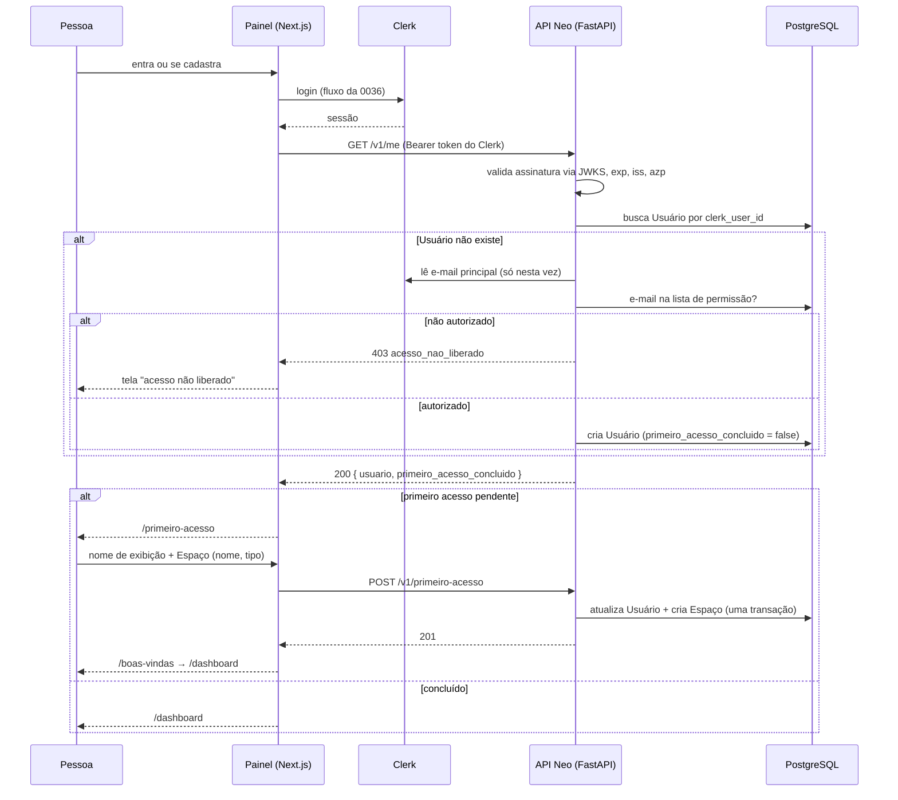
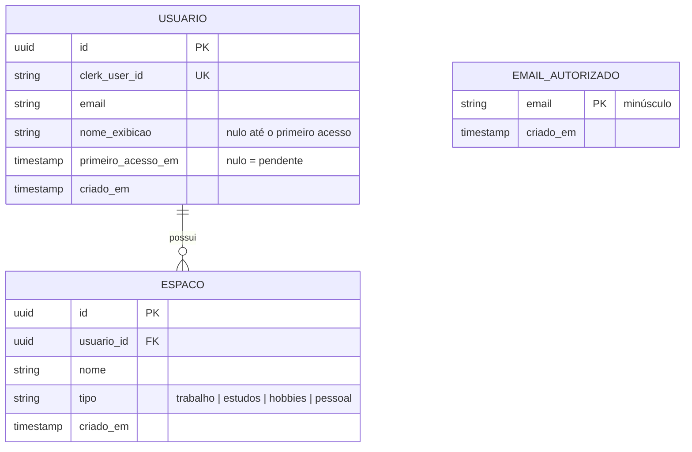

# Technical Design Doc — Fundação da API e primeiro acesso

> **Tier:** arquitetural · **Status:** aprovado (22/11/2026)
> **Autor:** Thalyson Wilker (com agente) · **Revisores:** Thalyson Wilker · **Data:** 2026-11-22

## Links e artefatos

| Artefato | Onde | Link |
|---|---|---|
| Product | repositório | [product.md](product.md) |
| Domínio · Spec · Tasks | repositório | [domain.md](domain.md) · [spec.md](spec.md) · [tasks.md](tasks.md) |
| Decisão de backend | repositório | [ADR-0011](../../docs/architecture/adr/0011-api-fastapi-com-postgresql.md) (aceito) |
| Painel e Clerk | repositório | [ADR-0010](../../docs/architecture/adr/0010-painel-web-nextjs-com-clerk.md) · [0036](../0036-login-painel-web/design.md) |

## Contexto da funcionalidade
O Neo é uma CLI em Python (ADR-0002). A feature 0036 entregou o painel em Next.js (`web/`) com login do Clerk, mas as rotas de API do painel são dados de exemplo e não existe usuário do Neo. Para chegar a um painel de gerenciamento de projetos, é preciso um backend com banco de dados. A escolha foi **FastAPI** em vez de Django (análise de 22/11/2026: reaproveitar Pydantic, `httpx` e os contratos de provedores da CLI; o Next.js e o Clerk já cobrem telas e login).

## Goals / Non-goals
**Goals**
- API FastAPI em `src/neo/interfaces/api`, versionada em `/v1`, com OpenAPI e rota de saúde.
- Validar o token de sessão do Clerk localmente (JWKS), sem chamar o Clerk a cada pedido.
- Criar o usuário do Neo no primeiro pedido de um e-mail autorizado; recusar os demais.
- Persistir usuário e primeiro espaço em PostgreSQL (SQLAlchemy 2 + Alembic).
- Fluxo no painel: entrada → primeiro acesso → boas-vindas → painel.

**Non-goals**
- Projetos, tarefas e quadros; tela de gestão da lista de permissão; deploy em produção; migrar a CLI atual para as novas camadas.

## Glossário (da funcionalidade)
> Termos provisórios até o `domain.md`. Promover ao `docs/glossary.md` no mesmo PR.

| Termo | Descrição |
|---|---|
| **Usuário** | Pessoa com registro no Neo, ligada a uma identidade do Clerk (`clerk_user_id`). |
| **Lista de permissão** | E-mails autorizados a virar Usuário. Quem não está nela recebe 403. |
| **Primeiro acesso** | Etapa única após o cadastro: nome de exibição e primeiro Espaço. |
| **Espaço** *(nome provisório)* | Agrupador do painel (Trabalho, Estudos, Hobbies, Pessoal). **Não** é o workspace do provedor Git. Nome final no `domain.md`. |
| **Boas-vindas** | Tela exibida uma vez, ao concluir o primeiro acesso. |

## Design proposto

### Fluxo


### Contrato da API (v1)
| Método e rota | Auth | Entrada | Saída | Erros |
|---|---|---|---|---|
| `GET /health` | não | — | `{status: "ok", db: "ok"}` | 503 se o banco cair |
| `GET /v1/me` | sim | — | `{id, email, nome_exibicao, primeiro_acesso_concluido, espacos[]}` | 401 token, 403 não autorizado |
| `POST /v1/primeiro-acesso` | sim | `{nome_exibicao, espaco: {nome, tipo}}` | 201 com o mesmo corpo de `/v1/me` | 409 já concluído, 422 validação |

Erros seguem um corpo único: `{erro: "<codigo>", mensagem: "<pt-BR>"}`.

### Modelo de dados


### Camadas (só o necessário nesta feature)
```
src/neo/
  domain/identidade/        Usuario, Espaco, TipoEspaco, regras do primeiro acesso, portas (repositórios)
  application/identidade/   casos de uso: ObterOuCriarUsuario, ConcluirPrimeiroAcesso
  infrastructure/
    db/                     engine, sessão, modelos SQLAlchemy, repositórios, migrations Alembic
    clerk/                  verificador de token (JWKS) e leitura do e-mail
  interfaces/api/           app FastAPI, routers v1, dependência de autenticação, mapeamento de erros
web/
  src/lib/api/              cliente da API (anexa o token do Clerk)
  src/app/primeiro-acesso/  formulário
  src/app/boas-vindas/      tela de boas-vindas
```
A CLI atual (`commands/`, `integrations/`, `services/`) **não muda** nesta feature.

## Cobertura dos 5 eixos

### 1. Tech stack
- **FastAPI** + **Uvicorn**; **SQLAlchemy 2** (async, driver **asyncpg**) + **Alembic**; **PyJWT** com `PyJWKClient` para validar o token do Clerk; **pydantic-settings** para configuração.
- Dependências da API como **extra opcional** (`neo[api]`) para não pesar a instalação da CLI via PyPI.
- Versões exatas fixadas no `uv.lock` durante a implementação.

### 2. Arquitetura base
- Novo bounded context **Identidade** (Usuário, Espaço, Lista de permissão). Fronteira com o Clerk por uma porta `VerificadorDeToken` no domínio, implementada em `infrastructure/clerk`.
- Regra de dependência: `interfaces/api → application → domain ← infrastructure`.
- O painel só fala com a API Neo para dados; o Clerk continua só para identidade (ADR-0010).

### 3. Infra
- **PostgreSQL 17 em Docker** (`docker-compose.yml` na raiz) para desenvolvimento; banco separado para testes.
- Variáveis: `NEO_DATABASE_URL`, `CLERK_JWKS_URL`, `CLERK_ISSUER`, `CLERK_AUTHORIZED_PARTIES`, `CLERK_SECRET_KEY` (só para ler o e-mail). Segredos fora do repositório (ADR-0004).
- CORS liberado só para a origem do painel (`http://localhost:3100`).
- Reversão: migrations Alembic com `downgrade`; sem deploy nesta feature.

### 4. Qualidade
- **Unidade:** domínio e casos de uso com repositórios em memória.
- **Integração:** repositórios contra Postgres real (contêiner de teste).
- **API:** `httpx.AsyncClient` contra o app, com tokens assinados por uma chave de teste (JWKS falso). Um teste por AC.
- **Painel:** Vitest para o redirecionamento (primeiro acesso pendente ou concluído) e para o formulário.
- Gates: cobertura ≥ mínimo do projeto, Ruff, Mypy estrito em `src/neo`, mais os gates do painel. Novos comandos entram no `TESTING.md`.

### 5. Observabilidade
- Logs estruturados por pedido (método, rota, status, duração, `request_id`), **sem** token nem e-mail completo.
- Registro de recusas 401 e 403 (contagem) para detectar tentativas.
- `GET /health` verifica o banco.

## Mapa de dependências

| Dependência | Tipo | Descrição | Principais métodos / endpoints |
|---|---|---|---|
| Clerk JWKS | HTTP | chaves públicas para validar o token | `GET <frontend-api>/.well-known/jwks.json` |
| Clerk Backend API | REST | e-mail principal do usuário (só na criação) | `GET /v1/users/{user_id}` |
| PostgreSQL | banco | persistência | — |
| FastAPI, SQLAlchemy, Alembic, PyJWT | bibliotecas | servidor, ORM, migrations, JWT | — |
| `@clerk/nextjs` (painel) | biblioteca | obter o token para a API | `auth().getToken()` / `useAuth().getToken()` |

## Solução

| # | Bloco | Descrição | Status |
|---|---|---|---|
| 1 | Infra local | Postgres em Docker, configuração, extra `neo[api]` | definido |
| 2 | Domínio Identidade | Usuário, Espaço, regras do primeiro acesso, portas | definido |
| 3 | Persistência | modelos, repositórios, migration inicial | definido |
| 4 | Autenticação | validação do token, leitura do e-mail, lista de permissão | definido |
| 5 | Rotas v1 | `/health`, `/v1/me`, `/v1/primeiro-acesso` | definido |
| 6 | Gestão da lista de permissão | comando `neo api permitir <email>` (adicionar, listar, remover) | definido |
| 7 | Painel: primeiro acesso e boas-vindas | cliente da API, redirecionamentos, telas | definido |
| 8 | Gates e docs | `TESTING.md`, glossário, context-map, ADR-0011 | definido |

## Alternativas consideradas

| Alternativa | Prós | Contras | Por que (não) escolhida |
|---|---|---|---|
| **FastAPI + SQLAlchemy (escolhida)** | reaproveita Pydantic e `httpx`; async; OpenAPI nativo; mesmo pacote da CLI | ORM, migrations e admin configurados à mão | encaixa no código atual e no painel que já existe |
| Django + DRF (monólito modular) | ORM, admin e permissões prontos | duplica o que Next.js e Clerk já fazem; modelos diferentes dos da CLI | ganho do admin não compensa |
| Rotas de API do próprio Next.js | um só runtime | lógica em TypeScript, longe do domínio Python da CLI | quebraria o reuso com a CLI |
| Lista de permissão só no Clerk | bloqueia já no cadastro | regra fora do repositório, sem teste | complementar, não substituto (questão em aberto) |
| Usuário criado por webhook do Clerk | cria antes do primeiro pedido | exige endpoint público e túnel em dev | criação no primeiro pedido é mais simples |

## Trade-offs e consequências
- **+** Uma base Python para CLI e API; contrato OpenAPI gera tipos para o painel.
- **+** Autorização e lista de permissão testáveis no repositório.
- **−** Segundo processo para rodar localmente (API e Postgres além do painel).
- **−** Nova estrutura de camadas convive com a antiga da CLI até uma migração futura.
- **−** Mais um arquivo do painel passa a usar o Clerk (`src/lib/api/`), ampliando a lista do ADR-0010.

## Riscos

| Risco | Descrição | Prob. × Impacto | Mitigação |
|---|---|---|---|
| E-mail fora do token | o token de sessão padrão do Clerk não traz e-mail | alta × médio | ler pela Backend API na criação, ou adicionar claim customizada; decidir no spike |
| Conta criada no Clerk sem acesso | lista só na API | média × baixo | tela clara de "acesso não liberado"; avaliar lista do Clerk |
| Ambiguidade de "workspace" | conflito com o workspace Git | alta × médio | termo próprio definido no `domain.md` |
| Rotação de chaves do Clerk | JWKS em cache desatualizado | baixa × alto | cache com recarga ao achar `kid` desconhecido |
| Corrida no primeiro pedido | dois pedidos criam o Usuário juntos | baixa × baixo | `UNIQUE(clerk_user_id)` e tratar conflito |

## Roadmap da feature

| Fase | Entrega | Depende de |
|---|---|---|
| 1 (esta feature) | API no ar, usuário, lista de permissão, primeiro acesso e boas-vindas | — |
| 2 | Projetos e tarefas por Espaço | 1 |
| 3 | Integrações (GitHub, Bitbucket, Shortcut) servidas pela API | 2 |

## Questões em aberto
- [x] **Nome do agrupador:** Espaço (22/11/2026).
- [x] **Lista de permissão também no Clerk:** sim, configuração manual registrada no UAT (22/11/2026).
- [x] **Como editar a lista de permissão:** comando `neo api permitir <email>`, com listar e remover (22/11/2026).
- [x] **Tipos de Espaço:** 4 fixos — trabalho, estudos, hobbies, pessoal (22/11/2026).
- [ ] **E-mail via Backend API ou claim customizada** — verificar na documentação do Clerk durante a implementação (spike curto).

> Decisão difícil de reverter: [ADR-0011](../../docs/architecture/adr/0011-api-fastapi-com-postgresql.md).
